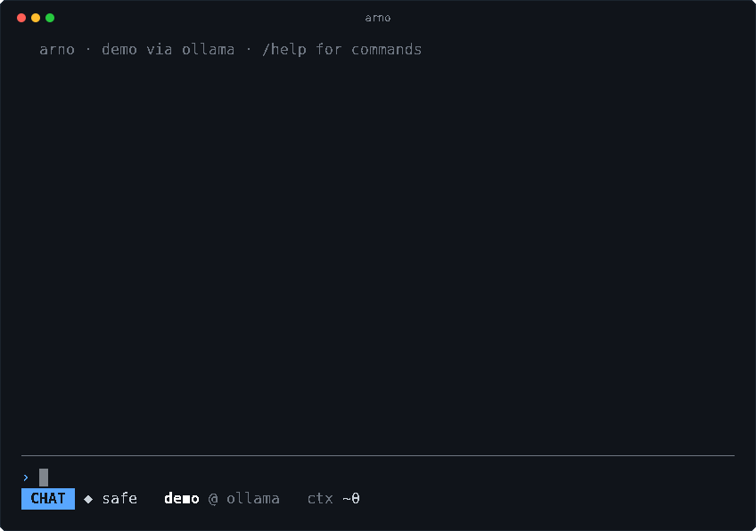

  

arno is a harness for language models in the terminal, written in
[raz](https://raz.lucelad.workers.dev). It sends a conversation to a
model (Ollama, Ollama Cloud, OpenAI, Gemini or Claude), streams the
reply, and lets the model read your project and change it through a
few tools, each one asking you before it reaches past what is safe.
Conversations are kept on disk. It runs as a full-screen session, as a
line-at-a-time filter, as a one-shot command, or as a server for
another program (a word processor, an editor) to drive.

The name comes from "harness", the thing arno is, cut down to be
typed often. The mascot is a river otter: a small, practical animal that fetches things and brings them back. It holds a terminal, with its prompt, and wears a
teal scarf. [`doc/img/arno-mascot.png`](doc/img/arno-mascot.png) is the
full picture; [`doc/img/logo.svg`](doc/img/logo.svg) is the emblem.

  

This is the raz rebuild of an earlier arno written in Pascal. It reads
the conversations that one saved. [PLAN.md](PLAN.md) has the decisions
and the stages.

## See it

Above, arno answers a greeting, runs a call of the model's that reads a
file, switches to review mode and counts its usage. The model is the
test suite's stub, so the replies are the same on every run. The same
recording is in [`doc/demo.cast`](doc/demo.cast), to play in your
terminal with [asciinema](https://asciinema.org):

    asciinema play doc/demo.cast

It is made, not filmed: `make cast` types `doc/demo.keys` at arno on a
pseudo-terminal (`test/Play.raz`, `test/cast.cn`).

## Get it

You need Linux, `make`, [raz 0.25.3](https://raz.lucelad.workers.dev)
on your `PATH`, and the OpenSSL development files (the default TLS
backend; `TLS=gnutls` selects rnet's GnuTLS one). arno links libc,
pthreads and the TLS libraries. `make check` also needs
[concha](https://github.com/ldiaz94/concha).

arno is built over its sibling libraries. rnet (HTTP and TLS) is a
directory beside arno's; rtui, rjson, rzone, rwalk, rterm and rlsp are
installed into `~/.raz/lib` first, with `make install` in each checkout.

    mkdir workspace && cd workspace
    for r in arno rnet rtui rjson rzone rwalk rterm rlsp; do
        git clone https://github.com/ldiaz94/$r.git
    done
    for r in rtui rjson rzone rwalk rterm rlsp; do (cd $r && make install); done
    cd arno
    make              # build/arno
    make check        # the tests
    make install      # arno and its manual pages into ~/.local

`make install` also puts in `arno-claude`, which writes what Claude Code
learned of each project (its memory and `.claude/rules`) into arno's own
context file for the project, and the systemd user timer that runs it
hourly; `systemctl --user enable --now arno-claude.timer` turns that on.

`make install` puts `arno` in `~/.local/bin` and its manual pages in
`~/.local/share/man`. For another place for rnet, set `RNET`. The
[Makefile](Makefile) has the other settings.

Then choose a provider. Make `~/.config/arno/config` (or
`$XDG_CONFIG_HOME/arno/config`), a text file with one `key = value`
to a line and `#` for a comment:

    provider = ollama
    model = llama3.2

A line that begins with a blank or a tab goes on with the setting above
it, so a long value can stand on several lines:

    trust = man fd
        linear-server_list_issues
        linear-server_get_user

| Provider | `provider =` | Key, read from the environment |
|---|---|---|
| Ollama | `ollama` | none |
| Ollama Cloud | `ollama-cloud` | `OLLAMA_API_KEY` |
| OpenAI | `openai` | `OPENAI_API_KEY` |
| Gemini | `gemini` | `GEMINI_API_KEY` |
| Claude | `claude` | `ANTHROPIC_API_KEY` |

The config never holds a secret: `key` names the variable. Put
`provider` first, since choosing one resets its settings; `model`,
`url`, `key` and `dialect` (`openai` or `anthropic`) then override the
preset. With no config, arno uses Ollama at
`http://localhost:11434/v1`. Of the other keys, arno sends `temperature`,
`top_p` and `max_tokens` (and `anthropic_version` to Claude) in the
provider's request, and drops the rest.

A section gives a tree of projects settings of its own: the lines after
`[~/r]` are for every project under `~/r`, a deeper section winning, and
only the keys of a project (`run`, `trust`, `test_cmd`, `check.NAME`, `safety`,
`jail_net`, `jail_rw` and the like) may be set there:

    run = tiza man fd

    [~/r]
    run = raz robbie make
    test_cmd = make check

    [~/w/webapp]
    jail_net = yes
    jail_rw = ~/.npm

Only this file holds sections; nothing in a project is read for them, so
a cloned repository grants itself nothing.

## Learn it

From the project you want to work on:

    arno                          # a session: the full screen on a terminal
    arno 'Explain how the config is loaded.'    # one turn, new conversation
    arno --resume ID 'Simplify it.'             # one more turn of a saved one
    arno --serve                  # one session, for a program that drives it
    arno --attach [PID | -l]      # show another arno's session here, and type into it
    arno -h | --version

The reply goes to standard output as it streams; tool calls and
questions go to standard error. With no terminal, each line of
standard input is a message or a command, and a question is answered
by a line: `y`, `n`, or `a` for always. After a `n`, the next line
says why. `ID` is a number from `/list` or a word of a title. The
exit status is 0 for a reply, 1 for a failed request or a
conversation not found, 2 for a mistake on the command line, and 130
for a turn stopped by C-c.

`man arno` has all of it. In a session, `/help` lists the commands;
these are the ones to start with:

| Command | What it does |
|---|---|
| `/new`, `/clear` | start a fresh conversation, or clear this one |
| `/list [WORD]`, `/load N\|ID\|WORD` | find and resume a saved conversation |
| `/mode [NAME]` | `chat`, `review`, `improve`, `pair` or `build`; `review` and `improve` offer no editing tools; `build` plans with you, then leads workers through the approved plan |
| `/model [NAME]`, `/models`, `/provider [NAME]` | switch, or list, what answers |
| `/budget [DOLLARS]` | what a turn may spend, workers included; 0 for no limit |
| `/compact [FOCUS]` | replace the history with a summary |
| `/tools`, `/usage` | the tools on offer; tokens and cost |
| `/mcp [login NAME]` | what became of each MCP server; log in to one |
| `/test [COMMAND]` | set and run the project's test command |
| `/remember [#tag,...] FACT`, `/forget`, `/my-memory` | facts kept for every conversation |
| `/notes` | this project's notes |
| `/stage [drop]` | the stage's copy: what it holds, or drop it |
| `/safety [auto\|safe]` | `auto` works on a copy, `safe` asks each change |
| `/quit` | leave (so does C-d) |

Attach a file with `@src/Arno.raz`, a line range with
`@src/Arno.raz:1-40`, or a path with spaces with `@"my file.txt"`.
Directories and images work too, if the model takes images.

| Key (full screen) | What it does |
|---|---|
| RET, M-RET | send; a new line in the input |
| C-c, C-d | stop the turn; quit |
| C-z | stop arno as a shell does; `fg` brings it back |
| S-Tab | change mode |
| TAB, C-o | toggle a tool entry, all of them |
| PgUp, PgDn; Up, Down, the wheel | scroll by a page, by a line |
| C-p, C-n; M-p, M-n | input history; by prefix |
| C-r | search the history |
| C-x C-e | edit the input in your editor |
| C-v | paste an image from the clipboard |
| M-v | copy mode: move, select and copy (OSC 52) as in tmux |

Completion offers commands and `@paths`. The man page has the other
keys, the copy-mode keys, and the config keys.

### What the model may do

The model has tools: `read`, `find`, `grep`, `def`, `outline`, `git`,
`run`, `check`, `edit`, `move`, `remove`, `note`, `skill` (your how-to for a kind of work, from
`~/.config/arno/skills/NAME.md`, its first line what it is for, read
when the work calls for it), `search`, `fetch`,
`delegate` (when the config names `workers`; each step picks its model, the first by default), `merge` (a staged worker's diff, into the copy or
dropped), `plan` (in `build` mode), `shell`, and, while a
text editor is reachable, `editor` and `open`. It reads freely inside the project; outside, it needs a
grant. Each change to a file shows its diff and asks. `run` is limited
to programs the config allows, and `ls wc head file stat`, which
only read. `check` runs the test command you set, or a named `check.NAME` one (say
`check.unit = npx vitest run {}`), the model giving the files that fill the `{}`:
each must exist inside the project; the command itself is always yours.

**The stage.** By default (`safety = auto`) the model works on a copy of
the project, and a turn's changes reach you as one diff and one question,
not one yes per edit. Nothing is applied to your tree without your yes.
`/safety safe` (or `safety = safe` in the config) asks each change
instead, and has no shell. With no git repository or no commit there is
no copy, and the session is safe. Staged, each worker gets a copy of its
own, made from the session's, and hands back a diff the model merges or
drops; safe, workers work in your tree, each change asked.

**The shell.** `shell` runs a command inside a jail made of Linux's
unprivileged namespaces (no root, no helper), with no network unless
the config says `jail_net = yes`.
In the stage it writes in the copy, never in your tree. It is offered only
staged, so not in safe mode, and is off if the config says `shell = no`.

**MCP servers.** A server of the Model Context Protocol, a program that
offers tools over standard input and output, or a URL that offers them
over HTTP, is added to the config, a line each:

    mcp = files npx -y @modelcontextprotocol/server-filesystem /home/me/work
    mcp = linear https://mcp.linear.app/mcp

A server at a URL that needs a login is logged in to once, by
`/mcp login NAME` in the browser; the login is kept in
`~/.local/share/arno/mcp/`, readable by you alone, and its token renewed
as it runs out. Or `mcp_token.NAME = pass linear/mcp` gives a command
whose first line is the token, so the secret stays in your password
store.

Its tools reach the model as `NAME_TOOL`, and every call asks first,
with the arguments shown (`a` answers always, for that tool until the
conversation changes). A server is somebody else's program: the
question is the only guard. To skip it for tools you know, name them in
`trust`: a tool (`linear_list_issues`), a whole server (`linear`), or
the tools that begin so (`linear_get_*`, which takes in tools the
server adds later).

**Serve and attach.** `arno --serve` runs one session for the program
that started it, speaking the protocol of `arno-serve(5)` on standard input
and output; the host can offer tools of its own. `arno --attach`
shows any arno's session, a terminal's or a host's, in your terminal
and types into it.

**Editors.** A text editor that speaks `arno-peer(5)`, such as dwa, can
ask arno, in dwa `:ask QUESTION` over some lines, and arno answers in the
editor when its turn ends; without a question the lines go into arno's
input as an `@` reference. The ask shows in the transcript as coming
from the editor, never as something you typed. While an editor is
reachable (the one that asked last, `$ARNO_EDITOR`, else the best
`dwa-PID.sock` in `$XDG_RUNTIME_DIR`), `read` gives a file as the editor
has it, unsaved changes and all, and an approved `edit` is made by the
editor, as one of your own undo steps. The sockets are yours alone.

## How it works

Seven ideas, a few modules each, listed in the order to read them. Each
module opens with what it is, what it needs and what it leaves out.

**1. A conversation is data.** `Amsg` is the messages as records, read
and written as JSON back byte for byte. `Awire` sends them to a
provider in OpenAI's or Anthropic's wire format and reads the reply as
it streams. `Aconf` is the config; `Astore` keeps each conversation in
a file of its own, under a lock.

**2. Tools go through a fence.** `Afence` says where the model may reach
without asking: the project, a directory with a mark, at most two
levels up. `Afind` finds, searches and outlines files; `Arun` runs a
program to its end and catches what it writes; `Ahtml` turns a page to
text; `Aattach` makes the `@paths`. `Atools` lists the tools and runs
a call, asking when it must. `Alsp` asks the language server config
names for a file's type (`lsp.ts = ...`, on rlsp) what it finds wrong
with a file just edited, for the edit's result.

**3. The stage and the jail.** `Astage` is the copy of the project the
model works on, and the diff of what it did. `Ajail` is the sandbox
for `shell`, built of namespaces; `Ajailtest` is its test, apart from
the others because `Arun` is what runs a program in it.

**4. A turn is a loop.** `Agent` asks the model, runs the tools it
calls, and asks again with their results, until it answers with none.
`Aprompt` makes the system prompt from its sections; `Aahead` tells the
model what it would else spend its first steps finding out; `Amemory`
keeps the facts you asked it to; `Aprice` knows what a model costs;
`Amcp` brings the tools of MCP servers, programs or URLs.

**5. One session, many ways in.** `Asession` is the conversations of
one run and the commands typed between turns. `Aboard` is the
transcript, `Ascreen` the full screen on rtui, with `Acopy`,
`Acomplete` and `Ahistory` for its copy mode, completion and recall.

**6. A session can be seen from elsewhere.** `Aview` makes a session
something others can watch, and `Aframe` the messages on a pipe or
socket that stay open. `Aserve` is `--serve` and `Aview` with `Ascreen`
is `--attach`.

**7. An editor is a peer.** `Apeer` is `arno-peer(5)`: it listens for an
editor's asks, which `Ascreen` and `Asession` run as turns shown as the
editor's, with every forged ask refused (the reply socket must be a live
user's socket directly in arno's socket directory), and it calls the
editor, whose tools `Atools` offers while one is reachable. `Arno` ties
it all together: the command line.

## Correctness

Everything compiles with `-Werror`, and `make fmt` checks the layout.
The conversations the Pascal arno saved are read and written again
byte for byte (`make compat`). The man pages give no `groff -ww`
warning (`make man`, part of `make check`).

## Tests

`make check` runs them. Each module's `main` is its test, and the program
is tried end to end: `test/oneshot.cn` runs one-shot turns against
`test/Astub.raz`, a model of the test's own, with a staged shell and
an MCP server (`test/Amcpstub.raz`); `test/serve.cn` drives `--serve`
with a host (`test/Ahost.raz`); `test/peer.cn` drives a terminal's arno
over a pseudo-terminal with an editor in miniature (`test/Apeerhost.raz`),
which asks, is answered, is called, and tries every forged ask. It was
also tried against the real dwa. `Alsp`'s test talks to a language
server in miniature (`test/Alspstub.raz`), pushed, pulled, silent, dying
and missing, and in the jail; it was tried by hand against raz-lsp,
concha-lsp and typescript-language-server, in the jail and out. The README's recording is
made by `make cast`, which is not part of the check.

## Size

15 295 lines of code in 30 modules, with 2 905 of comment, measured
by `make loc`.

## Left out

- **`check` and `run` jailed when safe.** Safe, nothing they run was
  changed unasked, so they run as they are; staged, they are jailed
  with `shell`, and a test that needs the network or a cache in your
  home fails there.
- **The jail beyond x86_64.** It needs Linux 5.12 and x86_64.
- **MCP's pages and non-text.** `tools/list` is read to its first page,
  and content that is not text shows as `[type]`.
- **An editor's buffer list for `@` completion.** The `buffers` verb is
  in `arno-peer(5)`, but arno does not ask it.
- **Asks in a one-shot or a plain session.** Only a terminal's arno
  takes an editor's ask; one under `--serve` refuses it as its host's.
- **A peer check of the process behind a reply socket.** The name's pid
  must run and be yours, not be the asker's own.
- **A mouse.** The screen is keys alone.

[PLAN.md](PLAN.md) lists what is still open.

## Licence

[ISC](LICENSE). Copyright © 2026 Luis Díaz.
